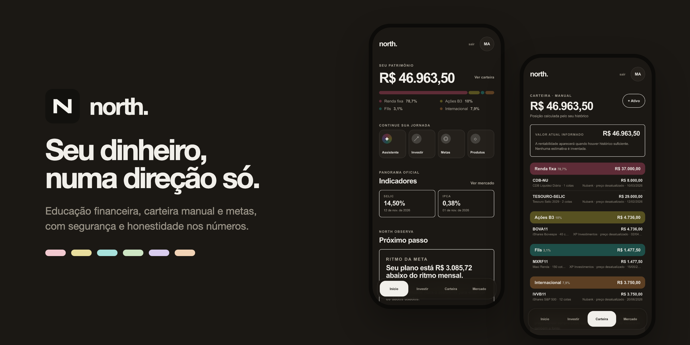
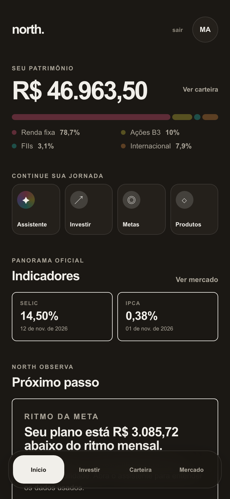
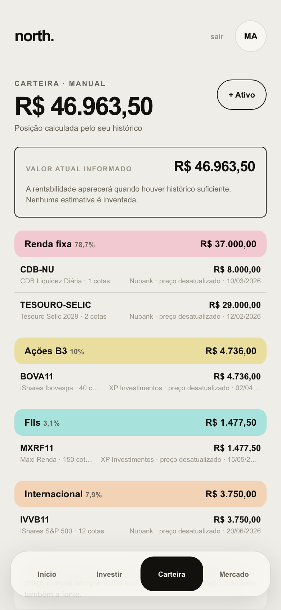
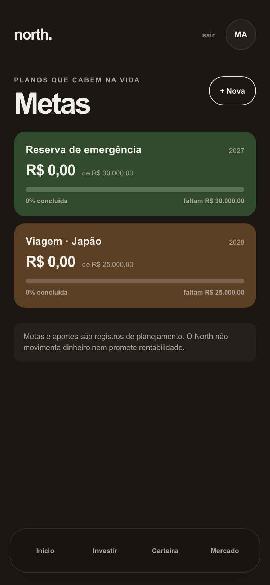
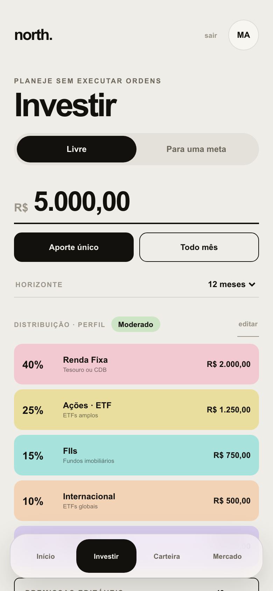

<p align="center">
  
</p>

<p align="center">
  <a href="#português">Português</a> · <a href="#english">English</a>
</p>

<p align="center">
  
  
  
  
  
</p>

---

## Português

**north.** é um app mobile-first de educação financeira. Você registra a carteira à mão, cria metas, simula aportes e conversa com um assistente que explica os números, sem prometer retorno e sem fingir certeza.

A regra central do app é simples: **nenhum número inventado**. Quando um dado ainda não chegou, a tela diz isso, com clareza e sem enfeite.

> Projeto de portfólio e de estudo. O conteúdo é educacional e não é recomendação de investimento.

### Como é por dentro

<table>
  <tr>
    <td></td>
    <td></td>
    <td></td>
    <td></td>
  </tr>
  <tr align="center">
    <td>Início</td><td>Carteira manual</td><td>Metas</td><td>Simulador</td>
  </tr>
</table>

As capturas usam uma conta fictícia, criada só para este README. Os valores de Selic e IPCA no Início são ilustrativos, inseridos no banco local para a imagem, porque a coleta real depende de fontes externas.

### O que já funciona

- **Cadastro e perfil de investidor:** consentimento versionado, questionário de 12 perguntas e carteira-alvo sugerida a partir do resultado.
- **Carteira manual:** movimentações e correções registradas num livro-razão. A posição é calculada pelo histórico, e o preço sempre mostra a data.
- **Metas:** objetivos com prazo, aporte planejado e progresso baseado só no que você registrou.
- **Simulador de aportes:** cálculo determinístico, ligado a uma meta ou livre, sem executar ordens.
- **Assistente "North":** responde com fatos calculados no servidor. O modelo de linguagem só explica.
- **Mercado e produtos:** indicadores oficiais (Selic e IPCA), fechamento da B3, cotações com atraso declarado e um catálogo de produtos por instituição.
- **Seus dados são seus:** exportar e apagar a conta direto no app.
- **PWA** com tema claro, escuro e do sistema, projetado para não guardar dados autenticados em cache.

### Como a IA entra, com honestidade

Há duas camadas, e é importante separar.

**No produto.** O modelo de linguagem é tratado como um componente não confiável. Regras de suitability, cálculos, limites e avisos vivem em código e têm testes. O servidor monta o contexto só com agregados autorizados, sem nome nem e-mail. A resposta passa por validação, e existe um fallback determinístico se o provedor falhar. Há orçamento e limite por pessoa antes de qualquer consumo.

**No processo.** O north foi construído com apoio de agentes de IA (Codex e Cursor), em marcos pequenos. Cada marco virou um pull request, com testes antes do merge. Os documentos de [arquitetura](docs/ARQUITETURA_E_DADOS.md) e de [segurança](docs/SEGURANCA.md) vieram antes do código e definem o que a IA pode e não pode fazer. A IA acelera, mas o que o produto precisa garantir está escrito e testado.

### Segurança em primeiro lugar

- **RLS nas tabelas** com dados de pessoas, bloqueando tudo por padrão, e **252 testes de banco (pgTAP)** que tentam acessar dados de outra conta.
- **Nenhum segredo no Git ou no navegador.** Só duas variáveis são públicas, e a chave privilegiada nunca sai do servidor. Há um workflow de varredura de segredos e o Dependabot ligado.
- Headers de segurança, CSP (hoje em modo `report-only`, para observar antes de bloquear) e validação de entrada com Zod nas APIs.
- O PWA foi desenhado para nunca guardar carteira, metas nem conversa em cache persistente.
- Princípio documentado: desenvolvimento, preview e produção usam projetos e segredos separados.

Detalhes em [docs/SEGURANCA.md](docs/SEGURANCA.md). Para relatar uma vulnerabilidade, veja [SECURITY.md](SECURITY.md).

### Stack

Next.js 15 (App Router), React 19, TypeScript estrito, Supabase (Postgres, Auth e RLS), Zod, Vitest, pgTAP, GitHub Actions e Vercel.

### Como rodar

Você precisa de Node 24, Docker e a [Supabase CLI](https://supabase.com/docs/guides/local-development).

```bash
npm ci
cp .env.example .env.local
supabase start          # sobe o Supabase local e aplica as migrações
supabase status -o env  # copie URL e chaves para o .env.local
npm run dev
```

No `.env.local`, preencha apenas `NEXT_PUBLIC_SUPABASE_URL`, `NEXT_PUBLIC_SUPABASE_PUBLISHABLE_KEY` e `SUPABASE_SECRET_KEY` com os valores do stack **local**. O `CRON_SECRET` precisa ter pelo menos 32 caracteres. Nunca use chaves de produção em desenvolvimento. O guia completo está em [docs/CONFIGURACAO_E_DEPLOY.md](docs/CONFIGURACAO_E_DEPLOY.md).

### Testes

```bash
npm run check     # lint, tipos, testes unitários e build
supabase test db  # testes de banco e de isolamento entre contas (RLS)
```

### Estrutura

```text
src/
  app/          rotas e composição das telas
  features/     onboarding, carteira, metas, mercado, assistente...
  server/       acesso a dados, integrações e código só de servidor
  styles/       tokens de cor e tema
supabase/
  migrations/   esquema versionado
  tests/        pgTAP, incluindo cenários negativos de RLS
docs/           arquitetura, segurança, plano e runbooks
```

### Status e próximos passos

O app roda de ponta a ponta com o stack local. A coleta diária de mercado depende de fontes e chaves externas, então localmente você vê o estado "aguardando primeira coleta". Próximos passos: revisar o contraste do tema escuro na tela do Assistente, adicionar testes de ponta a ponta (Playwright) para as jornadas críticas e publicar uma demonstração com dados fictícios.

---

## English

**north.** is a mobile-first financial education app. You log your portfolio by hand, set goals, simulate contributions and chat with an assistant that explains the numbers, without promising returns or faking certainty.

The core rule is simple: **no invented numbers**. When data has not arrived yet, the screen says so, plainly.

> Portfolio and learning project. The content is educational and is not investment advice.

### What it does

- **Sign-up and investor profile:** versioned consent, a 12-question questionnaire and a suggested target allocation.
- **Manual portfolio:** transactions and corrections recorded in a ledger. Positions are derived from history, and every price shows its date.
- **Goals:** targets with a deadline, a planned monthly amount and progress based only on what you recorded.
- **Contribution simulator:** deterministic math, tied to a goal or free-form, with no order execution.
- **"North" assistant:** answers with facts computed on the server. The language model only explains.
- **Market and products:** official indicators (Selic and IPCA), B3 closing prices, delayed quotes with a stated lag, and a product catalog per institution.
- **Your data is yours:** export and delete your account inside the app.
- **PWA** with light, dark and system themes, designed not to cache authenticated data.

### How AI is used, honestly

**In the product.** The language model is treated as an untrusted component. Suitability rules, calculations, limits and disclaimers live in code and are tested. The server builds context from authorized aggregates only, with no name or email. Output is validated, there is a deterministic fallback if the provider fails, and a budget plus per-user limits apply before any spend.

**In the process.** north was built with the help of AI agents (Codex and Cursor), in small milestones. Each milestone became a pull request with tests before merging. The [architecture](docs/ARQUITETURA_E_DADOS.md) and [security](docs/SEGURANCA.md) documents came before the code and set what the AI can and cannot do. AI speeds things up, but what the product must guarantee is written down and tested.

### Security first

- **RLS on tables** holding personal data, deny-by-default, plus **252 database tests (pgTAP)** that try to reach another account's data.
- **No secrets in Git or in the browser.** Only two variables are public, and the privileged key never leaves the server. Secret scanning and Dependabot are enabled.
- Security headers, CSP (currently `report-only`, to observe before enforcing) and Zod input validation on the APIs.
- The PWA is designed to never keep portfolio, goals or chat in persistent cache.
- Documented principle: development, preview and production use separate projects and secrets.

Details in [docs/SEGURANCA.md](docs/SEGURANCA.md) (Portuguese). To report a vulnerability, see [SECURITY.md](SECURITY.md).

### Stack

Next.js 15 (App Router), React 19, strict TypeScript, Supabase (Postgres, Auth, RLS), Zod, Vitest, pgTAP, GitHub Actions and Vercel.

### Running it

You need Node 24, Docker and the [Supabase CLI](https://supabase.com/docs/guides/local-development).

```bash
npm ci
cp .env.example .env.local
supabase start          # starts local Supabase and applies migrations
supabase status -o env  # copy the URL and keys into .env.local
npm run dev
```

In `.env.local`, fill only `NEXT_PUBLIC_SUPABASE_URL`, `NEXT_PUBLIC_SUPABASE_PUBLISHABLE_KEY` and `SUPABASE_SECRET_KEY` with the values from the **local** stack. `CRON_SECRET` must be at least 32 characters. Never use production keys in development. The full guide is in [docs/CONFIGURACAO_E_DEPLOY.md](docs/CONFIGURACAO_E_DEPLOY.md).

### Tests

```bash
npm run check     # lint, types, unit tests and build
supabase test db  # database tests and cross-account isolation (RLS)
```

### Status and next steps

The app runs end to end on the local stack. The daily market ingestion needs external sources and keys, so locally you will see the "waiting for first collection" state. Next: review dark-theme contrast on the assistant screen, add end-to-end tests (Playwright) for the critical journeys, and publish a demo with fictional data.

---

<p align="center">Feito por <a href="https://github.com/s1mh">Samuel Rocha</a>.</p>
